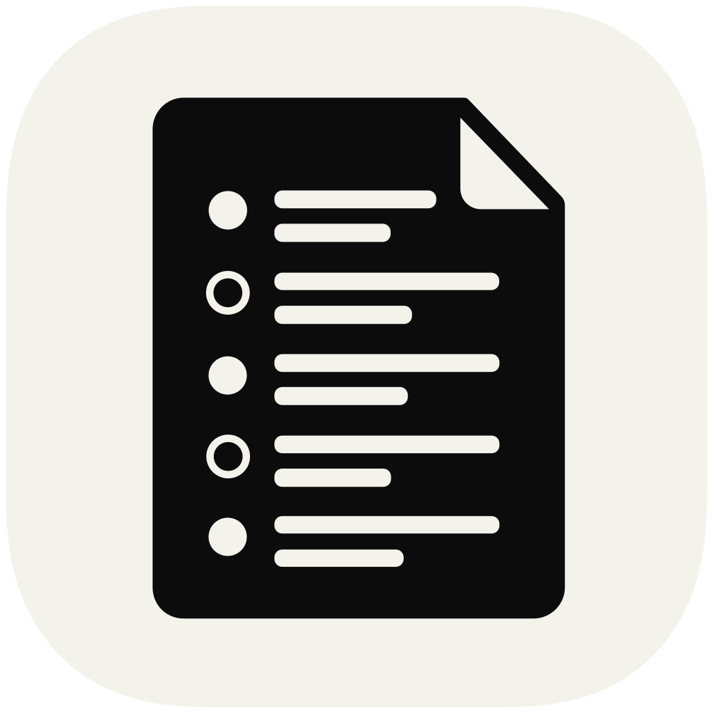

<p align="center">
  
</p>

# Scriba

[日本語](README.md)

A macOS CLI that records online meetings (Teams and others) locally and transcribes them chunk by chunk.

- **Stays on your Mac**: capture with sounddevice (CoreAudio), transcription with Haas (speech.cpp), with mlx-whisper available through configuration. Audio never leaves the machine
- **Two tracks**: the other participants (system audio via BlackHole) and you (microphone) are recorded separately and merged in time order with `[相手]` (them) / `[自分]` (you) labels
- **Incremental transcription**: each 2-minute chunk is transcribed as soon as it is complete, so you can read along during the meeting
- **Auto recording**: starts when a meeting app begins using the microphone, stops when it releases it
- **Calendar matching**: names the session from your calendar (iCalendar file/URL or JSON), infers organization and project, and writes them as frontmatter
- **Dictionary**: feeds proper nouns to the initial prompt, fixes recurring misrecognitions, and drops Whisper's typical hallucinations
- **Viewer**: a monochrome HTML viewer (`view --serve` adds live refresh and editing of the dictionary and settings)

Requires macOS 14.2+ on Apple Silicon. Japanese meetings are the primary target (`language = "ja"` by default; the UI and messages are in Japanese).

## Install

```bash
brew install blackhole-2ch switchaudio-osx ffmpeg
uv tool install --editable .
```

Then create a Multi-Output Device (BlackHole 2ch + your headphones) in Audio MIDI Setup and select it as the speaker in your meeting app. On an English macOS, set the device names in `~/scriba/config.toml`:

```toml
multi_output_device = "Multi-Output Device"
device_mic = "External Microphone"   # only used with capture_mic = true
```

## Usage

```bash
scriba start          # start recording (transcribes as it goes)
scriba stop           # stop (finishes the remaining chunks and notifies)
scriba status         # current state
scriba view --serve   # viewer
scriba watch on       # auto recording (start/stop with meetings)
```

Configuration lives in `~/scriba/config.toml` (override the folder with `SCRIBA_HOME`). Calendar matching:

```toml
calendar_source = "ics"
calendar_path = "https://calendar.example.com/private/basic.ics"   # or a local .ics file
```

The full command and configuration reference is in [docs/usage.md](docs/usage.md) (Japanese).

## Development

```sh
nix develop   # optional: uv, just, lefthook, gitleaks, ffmpeg, switchaudio-osx
just setup
just verify   # ruff + pytest + secret and private-info checks
```

See [docs/development.md](docs/development.md) and [CONTRIBUTING.md](CONTRIBUTING.md).

## License

[MIT](LICENSE). Licenses of the software used at runtime: [docs/third-party-licenses.md](docs/third-party-licenses.md).
