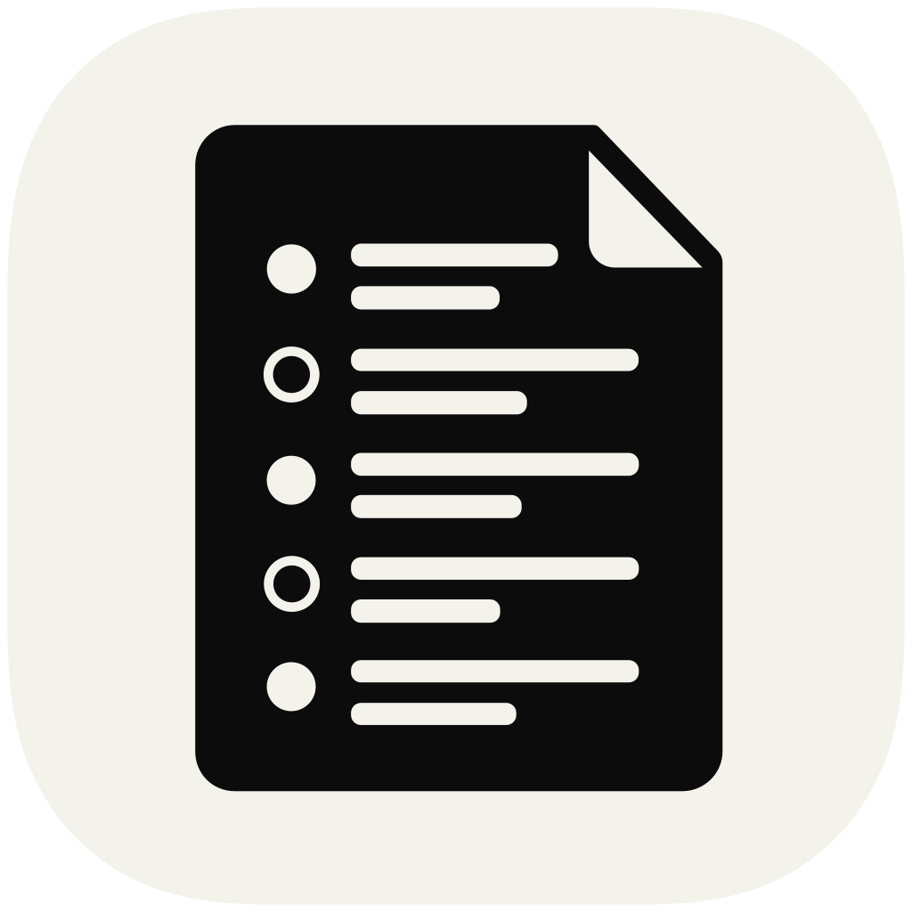
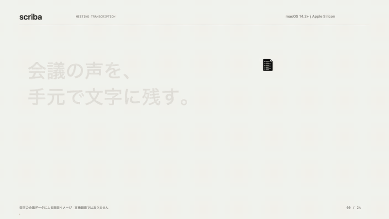
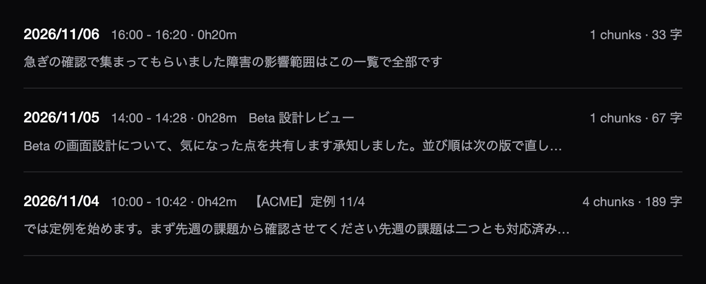
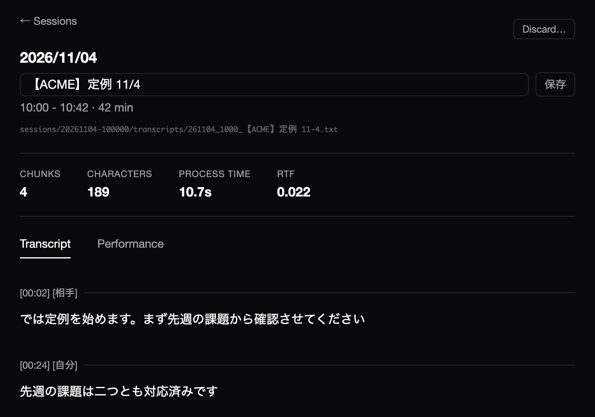

<p align="center">
  
</p>

# scriba

[English](README.en.md)

scriba は、オンライン会議の音声を Mac の中だけで録音し、2 分ごとに文字起こしする CLI です。

相手の声と自分の声を分けて録り、`[相手]` / `[自分]` のラベルを付けた時刻順のテキストにまとめます。予定表と照合して会議名と案件を付け、ノートアプリや要約の道具が読むフォルダへ渡すところまでを受け持ちます。

[](images/scriba-demo-ja.mp4)

*架空の会議データで作った紹介動画です。クリックすると音楽付きの 24 秒の動画を開きます。*

## 特徴

- **端末内で完結する。** 録音も文字起こしも Mac の中で行い、音声も本文も外へ送りません。ネットワークを使うのは、初回のモデル取得と、予定表に URL を指定したときの取得だけです。
- **話者を 2 つに分ける。** 相手の声は BlackHole 経由のシステム音声から、自分の声はマイクから録り、時刻順に並べます。
- **会議中から読める。** 2 分のチャンクごとに文字起こしするので、聞き逃した直前の発言を会議の最中に確かめられます。
- **録音の開始と停止を任せられる。** 会議アプリがマイクを使い始めたら録音を始め、終わったら止めます。待機画面だけや誤って入った会議など、60 秒未満の録音は捨てます（`min_keep_sec` で変更可）。
- **会議名と案件が付く。** iCalendar（.ics / URL）か JSON の予定から会議名を付け、メールのドメインとキーワードで組織と案件を推定して frontmatter に書きます。分類は規則だけで決め、LLM は使いません。
- **辞書で育てられる。** 固有名詞を認識のヒントに渡し、誤変換を置き換え、無音で出る定型句を捨てます。辞書を直したら、過去の会議も作り直せます。
- **ビューアで読む・直す。** モノクロの HTML ビューアで文字起こしを読み、辞書と設定を編集し、案件を選んで転送できます。
- **止めない作り。** 予定が取れない、発話検出が失敗する、といった場合も録音と文字起こしは続けます。無音の通知、切り忘れのタイムアウト（既定 3 時間）、無発話での自動停止も備えています。

## 出力の例

```text
---
title: 【ACME】定例 7/6
date: 2026-07-06
start: "09:15"
end: "10:00"
organization: ACME
project: acme
source_session: 20260706-091500
---

[00:00] [相手]
では、先週の課題から確認していきます

[00:21] [自分]
設計書の更新は昨日終わりました

[01:05] [相手]
ありがとうございます。次はレビューの日程ですね
```

*架空の会議の出力例です。時刻は録音開始からの経過で、案件が決まると `transcript/acme/` のように案件ごとのフォルダへ転送されます。*

ビューアでは、会議の一覧から文字起こしを開いて読めます。





*本体のビューアを、架空の会議データで描画しています。*

## 動作環境

macOS 14.2 以降の Apple Silicon Mac。日本語の会議を主に想定しています。

| 必要なもの | 用途 |
|---|---|
| [uv](https://docs.astral.sh/uv/) | インストールと、文字起こし・発話検出の別プロセス実行 |
| [BlackHole 2ch](https://github.com/ExistentialAudio/BlackHole) | 会議アプリの音声を録音に回す仮想デバイス |
| [switchaudio-osx](https://github.com/deweller/switchaudio-osx) | 録音中だけ出力先を切り替える |
| ffmpeg | Whisper 系のモデルを使うとき |

## 音声認識モデル

既定は Haas-ja-v1.0 の Q4_K 版（speech.cpp）です。`model` に Whisper 系の名前を書けば、従来の mlx-whisper も使えます。

| モデル | 120 秒の音声の処理時間 | ピークメモリ |
|---|---:|---:|
| Haas-ja-v1.0 Q4_K（既定） | 3.1 秒 | 479 MiB |
| Whisper large-v3-turbo | 14.7 秒 | 2,564 MiB |
| Whisper large-v3 | 41.3 秒 | 5,095 MiB |

*M4 / 32 GiB での実測。処理時間は 3 回の中央値で、モデルの読み込みと発話検出を含みます。認識精度は比較していません。*

重い依存（speech.cpp、mlx-whisper、Silero VAD）は scriba の依存に入れず、別プロセスで呼びます。理由は [ADR-003](docs/adr/003-heavy-deps-in-subprocess.md) にあります。

## インストール

```sh
brew install blackhole-2ch switchaudio-osx ffmpeg
uv tool install --editable .
scriba setup-model   # Haas の実行ファイルと重み（約 353 MB）を取得して検証
```

続けて、Audio MIDI 設定で「複数出力装置」（BlackHole 2ch + ヘッドフォン）を作り、会議アプリのスピーカーをその装置にします。OS の出力は録音中だけ scriba が切り替え、停止時に戻します。手順は [使い方](docs/usage.md#セットアップ) にあります。

マイクの許可は、scriba を起動したアプリから受け継ぎます。Raycast など、マイクの許可を持つアプリから実行してください。許可のないターミナルから起動すると、エラーにならずに無音で録れることがあります。

## 使い方

```sh
scriba watch on       # 自動録音を有効にする（会議の開始・終了で録音を開始・停止）
scriba start          # 手動で録音を始める
scriba stop           # 止めて、残りを文字起こしする
scriba status         # 録音中か、未転送の会議が何件あるか
scriba view --serve   # ビューアを開く
```

| 場面 | すること |
|---|---|
| 予定外の会議で案件が付かなかった | `scriba export <id> --project <案件>` か、ビューアで案件を選ぶ。選んだ案件は次の同じ定例から自動で付く |
| 誤変換が目立つ | 辞書に足して `scriba merge <id>` で作り直す |
| 遅れて始めて会議名が付かなかった | `scriba title <id> <会議名>` |

Raycast から操作するための Script Command を [raycast/](raycast/) に置いています。コマンドと設定の一覧、予定との照合、転送、辞書、データの場所は [使い方](docs/usage.md) を参照してください。

## できないこと

- 相手側の複数の話者は区別しません。system トラックは 1 人として扱います。
- 要約や議事録の整形はしません。文字起こしを、後段の道具に渡す素材として残します。
- 1 台の Mac・1 人・同時に 1 録音が前提です。

## 開発

```sh
nix develop   # 任意
just setup
just test
just verify
```

手順は [開発手順](docs/development.md)、仕様と技術判断は [ドキュメント一覧](docs/README.md) にあります。録音や文字起こしの扱いは、所属組織や会議の取り決めに従ってください。データの扱いは [SECURITY.md](.github/SECURITY.md) にあります。

## ライセンス

[MIT](LICENSE)。実行時に使うソフトウェアのライセンスは [docs/third-party-licenses.md](docs/third-party-licenses.md) にあります。
